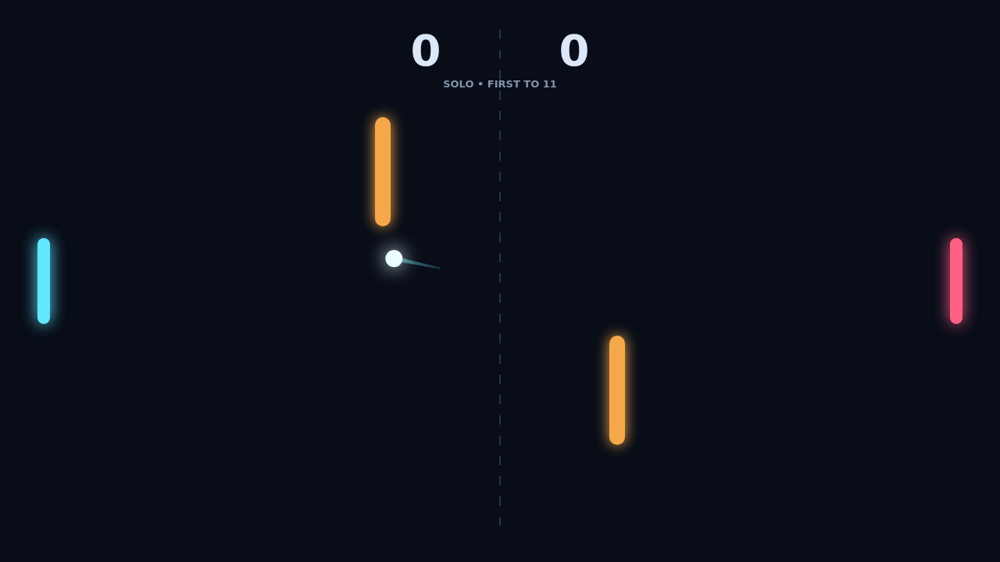

# Carom

A match opens with a clean serve toward the player who needs it. Move into position, read the incoming line, and send the ball back across the dark field before it slips past your paddle.

Your paddle’s motion gives the ball spin. A downward sweep bends the flight down; an upward sweep bends it up. Learn to shape a rally instead of merely returning it, then use the amber bumpers to bank a shot through a new angle.

Play solo against a quick computer opponent or challenge a friend on the same keyboard. Rally speed builds with every paddle contact, and match point only arrives when a player leads by two.

